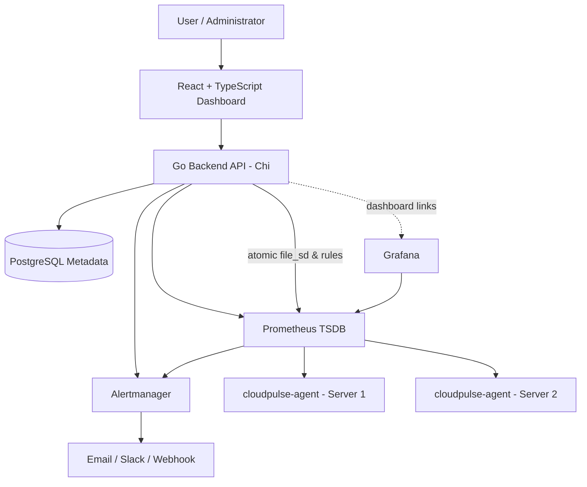
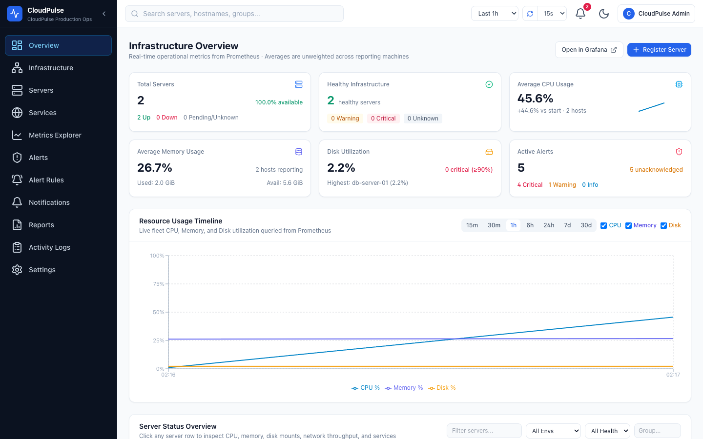
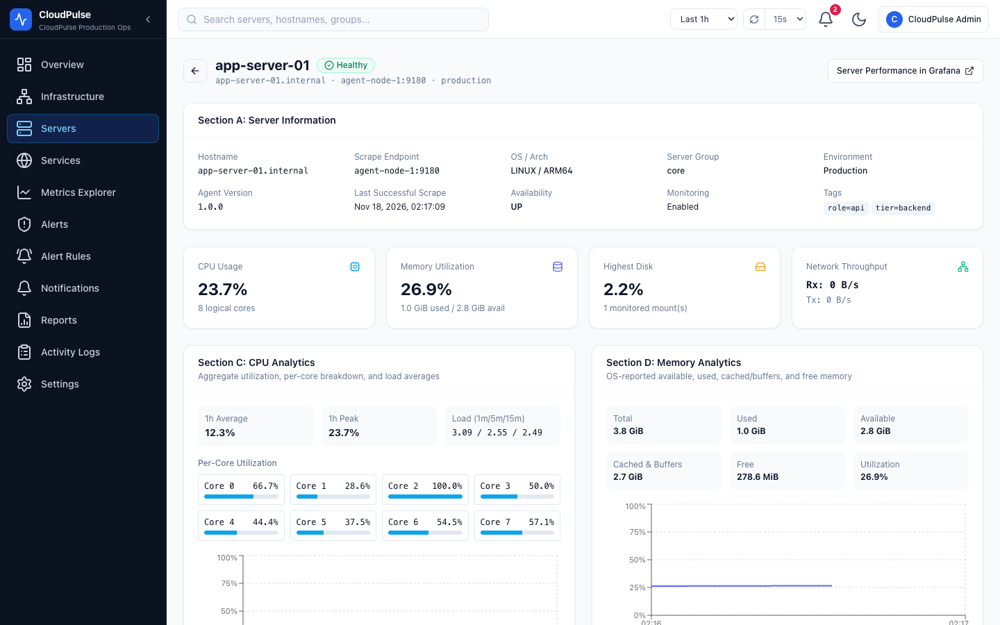
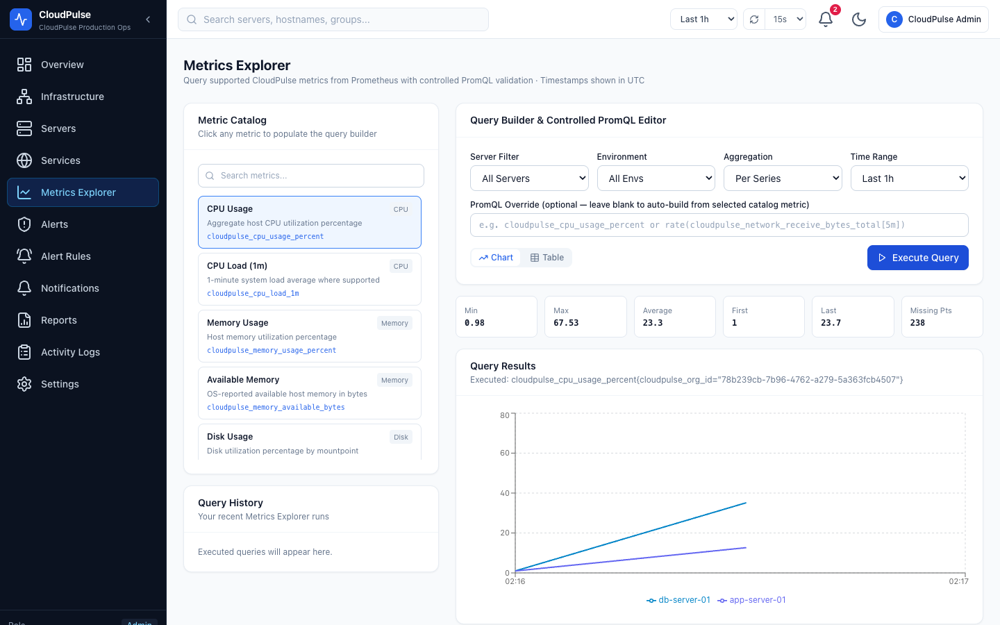
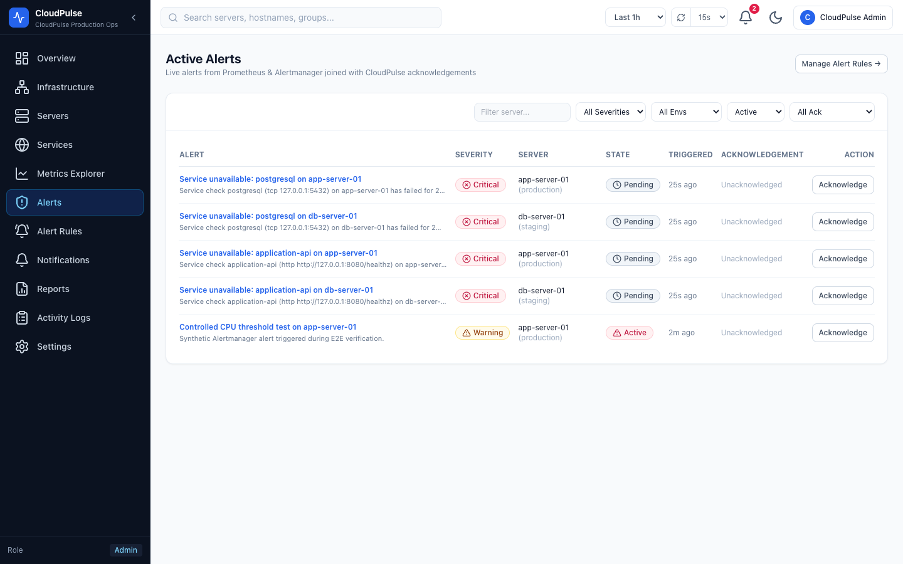
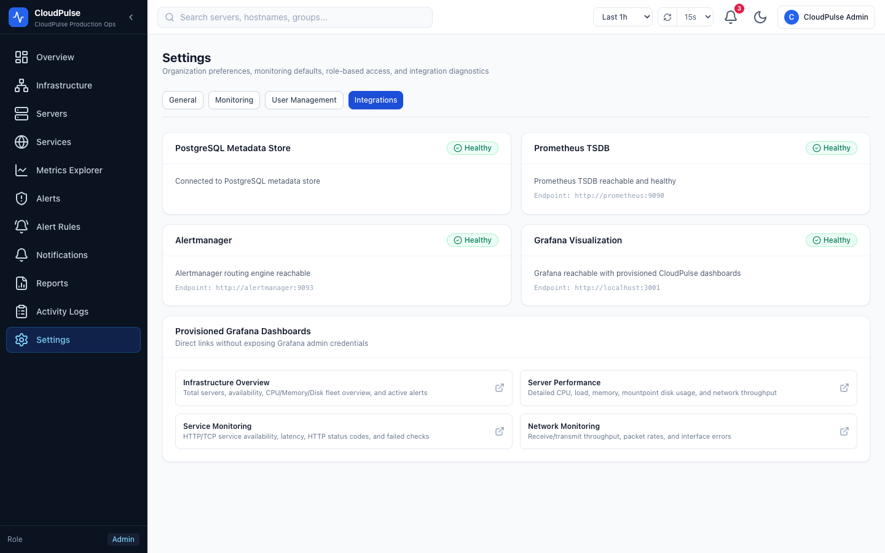
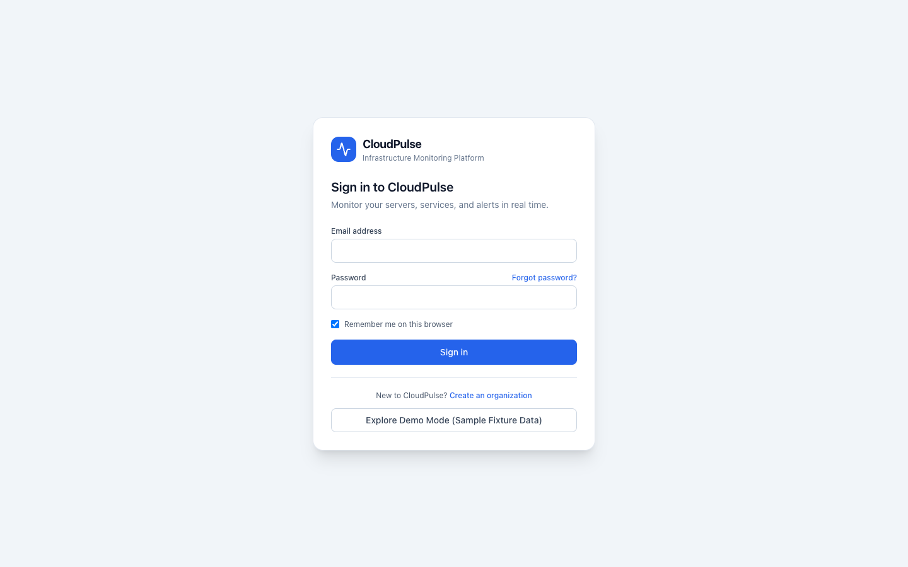

# CloudPulse — Infrastructure Monitoring Platform

**Repository:** https://github.com/lokeshpuma/cloudpulse-go  
**GitHub Pages Frontend Demo:** https://lokeshpuma.github.io/cloudpulse-go/

CloudPulse is a full-stack infrastructure monitoring platform built with **Go**, **React + TypeScript**, **PostgreSQL**, **Prometheus**, **Grafana**, and **Alertmanager**. It monitors the health, availability, CPU, memory, disk, network throughput, and HTTP/TCP services of multiple machines through a centralized web dashboard.

> **Core Principle:** Every operational metric displayed in CloudPulse is collected from a live `cloudpulse-agent` and queried from Prometheus. Newly registered servers start in `PENDING` status until Prometheus completes a scrape, missing or stale telemetry is never shown as `UP` or zero, and fixture data is strictly isolated inside explicitly enabled **Demo Mode**.

---

## Table of Contents

1. [Main Features](#1-main-features)
2. [Architecture](#2-architecture)
3. [Technology Stack](#3-technology-stack)
4. [Screenshots](#4-screenshots)
5. [Repository Structure](#5-repository-structure)
6. [How to Run on Your Own System (Docker Compose — Fastest)](#6-how-to-run-on-your-own-system-docker-compose--fastest)
7. [How to Monitor Your Own Machine & Remote Servers](#7-how-to-monitor-your-own-machine--remote-servers)
8. [Local Development Setup (Go + React Hot Reload)](#8-local-development-setup-go--react-hot-reload)
9. [Running All Automated Tests](#9-running-all-automated-tests)
10. [API, Prometheus, Grafana & Alerting](#10-api-prometheus-grafana--alerting)
11. [Environment Variables](#11-environment-variables)
12. [GitHub Pages Deployment](#12-github-pages-deployment)
13. [Production Deployment & Security](#13-production-deployment--security)
14. [Troubleshooting](#14-troubleshooting)

---

## 1. Main Features

- **Multi-Server Monitoring:** Register any number of Linux, macOS, or Windows hosts with environments, groups, and custom tags. CloudPulse atomically updates Prometheus `file_sd` targets and triggers configuration reload.
- **Standalone Go Agent (`cloudpulse-agent`):** Low-overhead binary collecting real host CPU (aggregate, per-core, core count, 1m/5m/15m load), OS-reported memory (`Available`, `Used`, `Cached+Buffers`, `Free`), disk mounts (with pseudo-filesystem exclusions), cumulative network byte/packet/error counters, and HTTP/TCP service probes with optional TLS expiry tracking.
- **Real-Time Web Dashboard:** 6 live KPI cards, multi-series Resource Usage Timeline (`15m`–`30d` + custom ranges), filterable/paginated server table, Server Detail analytics (Sections A–H), Infrastructure Overview, dark navy sidebar with light/dark theme toggle, and configurable auto-refresh.
- **Service Availability Monitoring:** Track HTTP and TCP endpoints independently of server availability, computing uptime strictly from valid collected intervals.
- **Metrics Explorer:** Searchable metric catalog, visual query builder, controlled PromQL editor, chart & tabular views, summary statistics (`min`, `max`, `avg`, `first`, `last`), missing-data indicators, and per-user query history.
- **Alerting & Alertmanager Integration:** 9 default Prometheus rules (CPU, Memory, Disk, Server Down, Service Down, Network Errors), custom rule CRUD + PromQL validation, Alertmanager routing/deduplication, PostgreSQL alert acknowledgements (without silently suppressing Prometheus), and Notification Center with Email/Slack/Webhook channel configs.
- **Provisioned Grafana Dashboards:** 4 pre-wired Grafana dashboards (`Infrastructure Overview`, `Server Performance`, `Service Monitoring`, `Network Monitoring`) with `server` and `environment` variables.
- **Reports & Audit Trail:** 4 report types with formula-injection-safe CSV, JSON, print-friendly HTML, and PDF print export, plus an append-only redacted Activity Log.
- **Authentication & RBAC:** Administrator, Operator, and Viewer roles enforced on all Go API routes; bcrypt password hashing; short-lived in-memory JWTs + HttpOnly SameSite rotating refresh cookies + CSRF protection; 6-step First-Time Onboarding wizard.

---

## 2. Architecture



Detailed architectural notes: [docs/architecture.md](docs/architecture.md).

---

## 3. Technology Stack

| Layer | Technologies |
|---|---|
| **Backend API** | Go, Chi v5, `pgx/v5`, PostgreSQL 16, JWT (`golang-jwt/jwt/v5`), bcrypt, `slog` JSON logging |
| **Monitoring Agent** | Go, `gopsutil/v4`, Prometheus `client_golang`, YAML config |
| **Frontend** | React 18, TypeScript, Vite, Tailwind CSS, Recharts, Lucide React, React Router, TanStack Query, React Hook Form, Zod |
| **Observability** | Prometheus `v2.55.1`, Grafana `11.5.2`, Alertmanager `v0.27.0`, Nginx `1.27.4` |
| **Containerization & CI** | Docker, Docker Compose, GitHub Actions, GitHub Pages |
| **Testing** | Go `testing` + Testify + `httptest`, Vitest + React Testing Library, Playwright E2E, Bash integration suite |

---

## 4. Screenshots

All screenshots were captured directly from the live Docker Compose stack scraping two live `cloudpulse-agent` instances via Prometheus:

### Live Infrastructure Overview Dashboard


### Server Detail Analytics (CPU, Per-Core, Load, Memory, Disk, Network)


### Metrics Explorer (Live PromQL Query)


### Active Alerts & Acknowledgement


### System Integration Diagnostics (PostgreSQL, Prometheus, Alertmanager, Grafana)


### Sign In


---

## 5. Repository Structure

```text
cloudpulse-go/
├── frontend/                   # React + TypeScript + Vite web dashboard
├── backend/                    # Go REST API, embedded SQL migrations, OpenAPI spec
├── agent/                      # Standalone Go monitoring agent + systemd unit
├── infrastructure/
│   ├── docker/                 # Pinned multi-stage non-root Dockerfiles
│   ├── prometheus/             # prometheus.yml, alert rules, file_sd targets
│   ├── grafana/                # Provisioned Prometheus datasource & 4 dashboards
│   ├── alertmanager/           # Alertmanager routing, grouping & inhibition config
│   └── nginx/                  # SPA + API reverse proxy config
├── docs/                       # Architecture, installation, deployment, security & ops guides
├── scripts/                    # Cross-platform agent build script
├── tests/                      # Playwright E2E suite & live Docker integration script
├── .github/workflows/          # CI workflow & GitHub Pages deployment workflow
├── docker-compose.yml          # Full self-hosted stack (+ optional live agents profile)
├── .env.example                # Environment variable template
└── LICENSE
```

---

## 6. How to Run on Your Own System (Docker Compose — Fastest)

### Prerequisites
- [Docker](https://docs.docker.com/get-docker/) and Docker Compose v2
- Git

### Step-by-Step

```bash
# 1. Clone the repository
git clone https://github.com/lokeshpuma/cloudpulse-go.git
cd cloudpulse-go

# 2. Create your environment file
cp .env.example .env

# 3. Start the full stack PLUS two built-in Go monitoring agents to see live metrics right away
docker compose --profile agents up -d --build

# (Or start only the core platform without the sample agent containers:)
# docker compose up -d --build

# 4. Verify every container is healthy
docker compose --profile agents ps
```

### Open the Applications

| Service | URL | Notes |
|---|---|---|
| **CloudPulse Dashboard** | http://localhost:3000 | Register your organization & admin account on first launch |
| **Go Backend API** | http://localhost:8080 | Health checks: `/healthz` and `/readyz` |
| **Grafana** | http://localhost:3001 | Default credentials in `.env` (`admin` / `change-me-grafana-password`) |
| **Prometheus** | http://127.0.0.1:9090 | Loopback only; inspect `/targets` and `/alerts` |
| **Alertmanager** | http://127.0.0.1:9093 | Loopback only |
| **PostgreSQL** | Internal Docker network only | Never exposed publicly |

### First-Time Usage Walkthrough
1. Open **http://localhost:3000** and click **Create an organization** (`/register`).
2. Complete the **6-step Onboarding Wizard**:
   - Step 3 pre-fills `app-server-01` with scrape address `agent-node-1:9180` (the first live Docker agent).
   - Step 5 polls Prometheus until the live scrape succeeds.
3. Go to **Servers → Register Server** to add the second live Docker agent:
   - Display Name: `db-server-01`, Hostname: `db-server-01.internal`, Scrape Address: `agent-node-2:9180`, Environment: `staging`.
4. Return to **Overview** (`/`) — within ~15 seconds, both machines transition from `PENDING` to `Healthy` with real CPU, memory, disk, and network metrics.
5. Click any server row for deep analytics, open **Metrics Explorer** to run PromQL queries, or click **Open in Grafana** to inspect the provisioned Grafana dashboards.

### Stopping & Managing Logs
```bash
docker compose logs -f          # Follow logs
docker compose down             # Stop containers while preserving persistent volumes
```

---

## 7. How to Monitor Your Own Machine & Remote Servers

### Build & Run `cloudpulse-agent` Natively on Your System

```bash
# Build standalone binaries for your OS plus linux/amd64 and linux/arm64
./scripts/build-agent.sh

# Run on your local machine
./bin/cloudpulse-agent --config ./agent/config.example.yaml

# Verify live endpoints
curl http://127.0.0.1:9180/health
curl http://127.0.0.1:9180/agent/info
curl http://127.0.0.1:9180/metrics | head -n 30
```

To scrape an agent running natively on your Mac/Windows host from Docker Prometheus, register its scrape address in CloudPulse as `host.docker.internal:9180` (binding `listen_address: "0.0.0.0:9180"` in the agent config).

### Linux VPS / Production Multi-Server Setup
For Linux servers, install `cloudpulse-agent` as a hardened non-root systemd service using [agent/deploy/cloudpulse-agent.service](agent/deploy/cloudpulse-agent.service) and connect remote hosts to Prometheus over a private VPN (WireGuard/Tailscale) rather than exposing port `9180` publicly.

Full guide: [docs/agent-installation.md](docs/agent-installation.md).

---

## 8. Local Development Setup (Go + React Hot Reload)

Prerequisites: Go 1.24+, Node.js 22+, npm, Docker.

```bash
# 1. Start backing infrastructure
docker compose up -d postgres prometheus-init prometheus grafana alertmanager

# 2. Run Go Backend API locally
cd backend
go mod download
go run ./cmd/api

# 3. Run React Frontend dev server (in a new terminal)
cd frontend
cp .env.example .env
npm install
npm run dev
# Opens on http://localhost:5173 (proxies /api to http://localhost:8080)
```

Full local dev notes: [docs/installation.md](docs/installation.md).

---

## 9. Running All Automated Tests

```bash
# Go Backend (fmt, vet, unit & API tests with race detector)
cd backend && go fmt ./... && go vet ./... && go test -race -v ./...

# Go Monitoring Agent (fmt, vet, collector/service/server tests with race detector)
cd agent && go fmt ./... && go vet ./... && go test -race -v ./...

# Frontend (TypeScript, ESLint, Vitest + React Testing Library, standard & GitHub Pages builds)
cd frontend && npm run typecheck && npm run lint && npm run test:run && npm run build && GITHUB_PAGES=true npm run build

# Live Docker Compose Integration Test (requires running stack with --profile agents)
./tests/integration/docker_stack_test.sh

# Playwright End-to-End Test Suite (requires running stack with --profile agents)
cd tests && npm install && npx playwright install chromium && npm run test:e2e
```

---

## 10. API, Prometheus, Grafana & Alerting

- **OpenAPI 3.1 Spec:** [backend/openapi.yaml](backend/openapi.yaml)
- **REST API Reference & RBAC:** [docs/api-reference.md](docs/api-reference.md)
- **Prometheus & PromQL Helpers:** [docs/prometheus.md](docs/prometheus.md)
- **Grafana Provisioning:** [docs/grafana.md](docs/grafana.md)
- **Alert Rules & Alertmanager:** [docs/alerting.md](docs/alerting.md)

---

## 11. Environment Variables

- **Backend & Docker Stack:** [.env.example](.env.example)
- **Frontend Public Build Variables:** [frontend/.env.example](frontend/.env.example) (`VITE_API_BASE_URL`, `VITE_APP_ENV`, `VITE_DEMO_MODE`)

> **Warning:** Never put passwords, JWT secrets, or webhook URLs inside `VITE_*` variables — Vite bundles them into public browser JavaScript.

---

## 12. GitHub Pages Deployment

The repository includes [.github/workflows/deploy-pages.yml](.github/workflows/deploy-pages.yml) configured for `https://lokeshpuma.github.io/cloudpulse-go/`:

1. Go to your GitHub repository → **Settings → Pages**.
2. Under **Build and deployment**, set **Source** to **GitHub Actions**.
3. Push to `main` (or trigger **Deploy Frontend to GitHub Pages** manually in the **Actions** tab).
4. By default, GitHub Pages deploys in explicitly marked **Demo Mode** (`VITE_DEMO_MODE=true`) so visitors can explore every dashboard page immediately without needing a backend server.
5. To connect GitHub Pages to your own self-hosted HTTPS Go backend, add GitHub repository **Actions Variables**:
   - `VITE_API_BASE_URL=https://api.yourdomain.com`
   - `VITE_APP_ENV=production`
   - `VITE_DEMO_MODE=false`

Full deployment details: [docs/deployment.md](docs/deployment.md).

---

## 13. Production Deployment & Security

- Set `APP_ENV=production`, `COOKIE_SECURE=true`, a random 32+ character `JWT_SECRET`, unique PostgreSQL/Grafana passwords, and explicit `CORS_ALLOWED_ORIGINS` (the backend refuses to start in production with placeholder defaults or wildcard CORS).
- In-memory JWT access tokens (never stored in `localStorage`), HttpOnly SameSite rotating refresh cookies, double-submit CSRF validation, bcrypt password hashing, rate limiting, SSRF webhook filtering, CSV formula-injection escaping, append-only redacted audit logs, and pinned non-root containers.
- Full hardening guide: [docs/security.md](docs/security.md).

---

## 14. Troubleshooting

Common issues (servers remaining `PENDING`, Prometheus outages, production config validation errors, CORS/CSRF cookies, macOS `-buildvcs=false`) are covered in [docs/troubleshooting.md](docs/troubleshooting.md).

---

## License

MIT — see [LICENSE](LICENSE).
