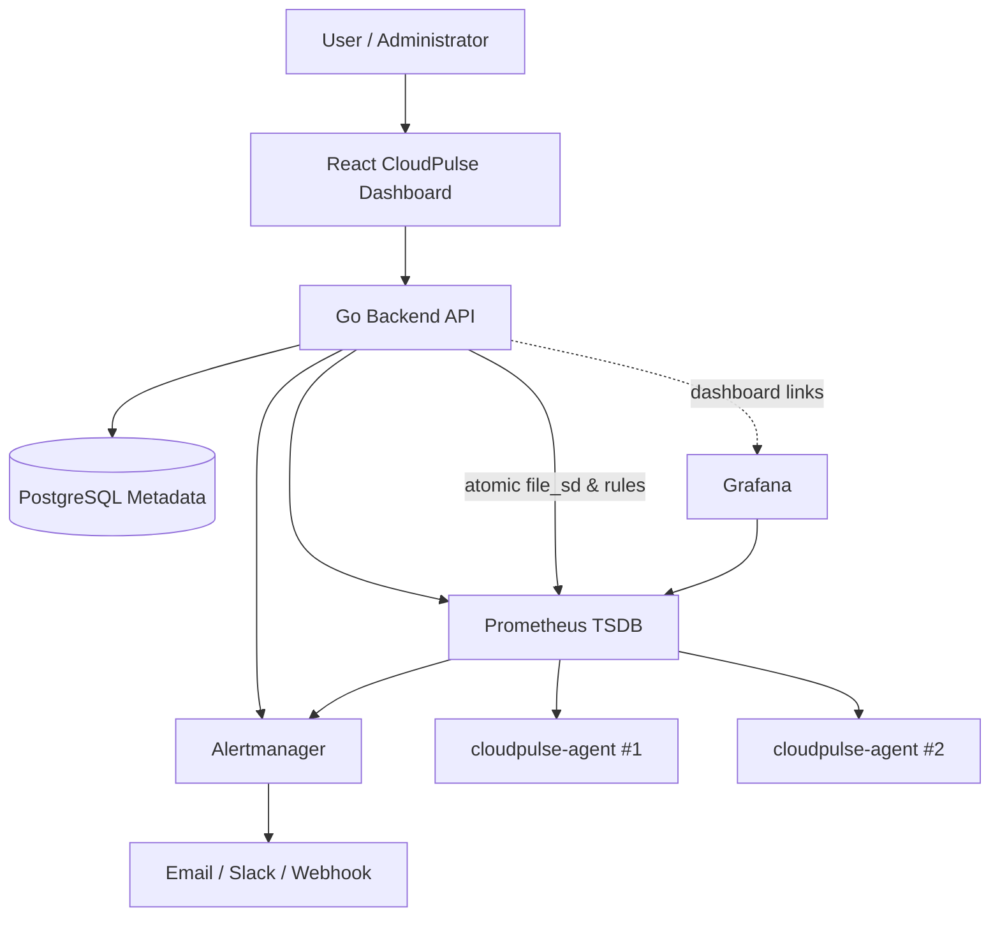

# CloudPulse Architecture

CloudPulse separates metadata management from time-series storage and alerting across six focused components:

| Component | Technology | Responsibility |
|---|---|---|
| Web Dashboard | React 18, TypeScript, Vite, Tailwind CSS, Recharts | Interactive monitoring UI, RBAC views, Metrics Explorer, Reports |
| Backend API | Go, Chi, pgx/v5, JWT, bcrypt | Authentication, RBAC, PostgreSQL metadata, Prometheus/Alertmanager API gateway, atomic `file_sd` sync |
| Monitoring Agent | Go (`cloudpulse-agent`), gopsutil/v4 | Real host CPU/Memory/Disk/Network metrics & HTTP/TCP service probes |
| Metrics Engine | Prometheus (`v2.55.1`) | Scraping agents via `file_sd_configs`, TSDB storage, PromQL, alert rule evaluation |
| Visualization | Grafana (`11.5.2`) | Provisioned dashboards backed by Prometheus |
| Alerting | Alertmanager (`v0.27.0`) | Alert grouping, deduplication, inhibition, and Email/Slack/Webhook routing |

## Data Flow

## Key Architecture Guarantees

- **No time-series duplication in PostgreSQL:** PostgreSQL stores only users, organizations, server inventory, tags, service definitions, alert rules, acknowledgements, notification delivery records, query history, and append-only audit logs.
- **No browser direct database access:** Every request goes through the Go API (`/api/v1`) with strict organization scoping and server-side RBAC.
- **Traceable metrics only:** Newly registered servers start as `PENDING` and only become `UP` after Prometheus completes a live scrape. Missing or stale metrics (>90s) degrade to `UNKNOWN` with a `Stale` badge, never `UP` or zero.
- **Single alerting engine:** Alertmanager handles deduplication and external notification routing. CloudPulse records operator acknowledgements in PostgreSQL without silently suppressing Prometheus alerts.
